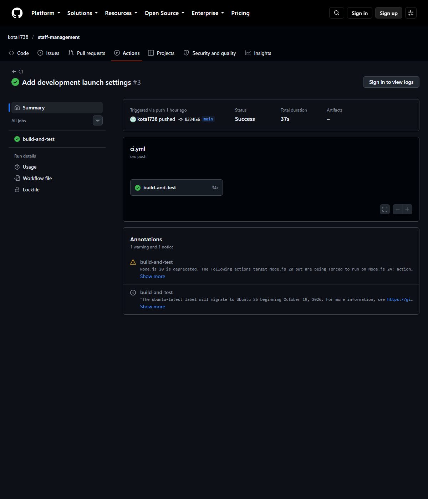

# Staff management system

C# / ASP.NET Core application over a relational database: staff records with
search, filtering and paging, cookie authentication, role-based permissions,
database-level constraints and an integration test suite that drives the real
HTTP pipeline.

Built as project 3 of three; the others are
[distributed-task-queue](../distributed-task-queue) and
[monitoring-stack](../monitoring-stack).

**Verified:** `dotnet test` → 16 passed. The API was also run and driven by hand:
`/healthz` 200, login 204 with a session cookie, `/api/auth/me` returns the role,
creating a member of staff 201, repeating the same email 409, and the list
endpoint returns the stored row.

Every push builds with warnings as errors and runs the suite in GitHub Actions
(about 35 seconds):



## What it does

| Area | Implementation |
| --- | --- |
| Staff records | Create, edit, delete, list; search across name, email and job title; filter by department; paging with a total count |
| Validation | Data annotations plus server-side checks; failures return a `ValidationProblemDetails` keyed by field |
| Authentication | Cookie sessions; PBKDF2-HMAC-SHA256 hashes, salted, iteration count stored with the hash |
| Authorisation | `Viewer` reads, `Manager` writes, `Admin` deletes and manages accounts — enforced by policies, not by UI |
| Database | EF Core; unique index on staff email and on account email; indexes on department and surname; SQL Server types (`nvarchar`, `datetimeoffset`, `decimal(18,2)`, `date`) |
| Errors | Problem details for 401/403/404/409; no stack traces leave the process |
| Tests | 16 integration tests through `WebApplicationFactory`, plus a test that proves the unique email is enforced by the database rather than only by the handler |
| Deployment | Multi-stage Dockerfile, Docker Compose with SQL Server 2022 and a healthcheck, migrations applied at startup |

## Roles

| Role | Read | Create/update | Delete | Manage accounts |
| :--- | :--- | :--- | :--- | :--- |
| Viewer | yes | no (403) | no | no |
| Manager | yes | yes | no (403) | no |
| Admin | yes | yes | yes | yes |

## Endpoints

| Method | Path | Access |
| --- | --- | --- |
| `GET` | `/healthz` | anonymous |
| `POST` | `/api/auth/login` | anonymous — sets the session cookie |
| `POST` | `/api/auth/logout` | authenticated |
| `GET` | `/api/auth/me` | authenticated |
| `GET` | `/api/staff?q=&department=&page=&pageSize=` | any role |
| `GET` | `/api/staff/{id}` | any role |
| `POST` | `/api/staff` | Manager, Admin |
| `PUT` | `/api/staff/{id}` | Manager, Admin |
| `DELETE` | `/api/staff/{id}` | Admin |
| `GET` | `/api/users` | Admin |
| `POST` | `/api/users` | Admin |

## Run it

Local, SQLite, no services:

```bash
dotnet run --project src/StaffManagement.Api \
  --property:Seed__AdminPassword=change-this-password
```

Production-like, SQL Server in Docker:

```bash
cp .env.example .env          # set MSSQL_SA_PASSWORD and SEED_ADMIN_PASSWORD
docker compose up --build
curl -s localhost:8081/healthz
```

```bash
dotnet test                   # 16 integration tests, SQLite, no services needed
```

## Deployed

Running on the home server, reached over loopback and an SSH tunnel:

```bash
./deploy.sh                   # REMOTE=kota@server, uses docker-compose.server.yml
```

`docker-compose.server.yml` exists because the server is aarch64 and the
`mssql/server` images are published for x86-64 only. That variant runs the same
binary against SQLite on a bind mount; the application supports SQLite already
(it is the default for local runs and the tests), so only the engine differs.
`docker-compose.yml`, with SQL Server, remains the deployment for an x86-64 host.

Verified against the running container:

```text
$ curl -s localhost:8081/healthz
{"status":"ok"} [200]

$ curl -s -c jar -X POST localhost:8081/api/auth/login \
    -d '{"email":"admin@example.com","password":"..."}'
[204]  # session cookie set

$ curl -s -b jar localhost:8081/api/auth/me
{"email":"admin@example.com","role":2}   # 0 Viewer, 1 Manager, 2 Admin

$ curl -s -b jar -X POST localhost:8081/api/staff -d '{..."email":"ada@example.com"...}'
{"id":1,"firstName":"Ada","lastName":"Lovelace",...,"createdAt":"..."} [201]

$ # same request again
{"title":"Email already in use","status":409,"detail":"A member of staff with the
 email 'ada@example.com' already exists."} [409]

$ curl -s -b jar 'localhost:8081/api/staff?q=lovelace&page=1&pageSize=5'
{"items":[{..."email":"ada@example.com"...}],"total":1,"page":1,"pageSize":5}
```

The container settles at about 85 MB with a 256 MB cap; port 8081 is bound to
`127.0.0.1` only. The seeded administrator password lives in `.env` on the
server, mode 600 — read it there rather than from this repository.

## Design decisions

- **Cookie auth, not bearer tokens.** The client is a same-origin application;
  HttpOnly cookies avoid storing credentials somewhere JavaScript can read.
  Login responses are identical for an unknown account and a wrong password, so
  the endpoint cannot be used to enumerate users.
- **Database constraints, not just validation.** The unique email index and the
  required columns are in the schema; a second request that races past the
  handler's pre-check still fails with 409, and a test inserts a duplicate
  directly to prove the index does the work.
- **Migrations target SQL Server.** Development and tests use SQLite with
  `EnsureCreated`; production applies the SQL Server migrations at startup. The
  provider is chosen by `Database:Provider`, so both paths are explicit rather
  than guessed from the connection string.
- **No seeded password by default.** The initial administrator is created only
  when `Seed:AdminPassword` is configured; an unattended deployment cannot come
  up with a known account.
- **Policies in code, not in the UI.** `Viewer`, `Manager` and `Admin` map to
  authorization policies, and the tests assert 401 and 403 at the HTTP layer.

## Limitations

- No audit trail: who changed a record and when is not recorded.
- No account lockout or rate limiting on `/api/auth/login`.
- Salary is stored as `decimal(18,2)` with no currency column.
- No OpenAPI document; the endpoint table above is the contract.
- The server deployment uses SQLite because the SQL Server image has no arm64
  build; the SQL Server path is exercised by migrations and CI, not by that host.
- One instance only: SQLite and in-memory sessions rule out scaling out without
  a shared database and shared data-protection keys.
- Sessions are per-instance in-memory cookies; scaling out would need shared
  data-protection keys.
